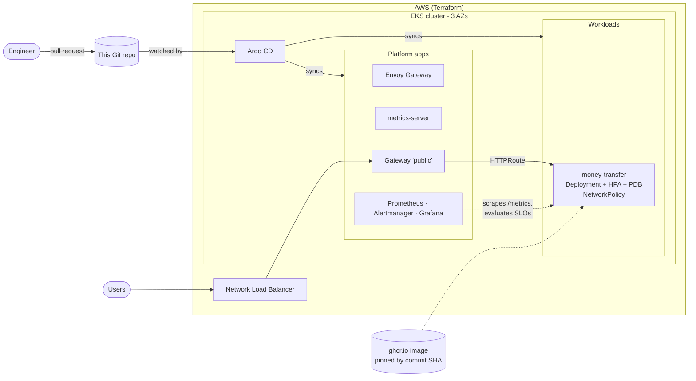

# EKS GitOps Platform

[](https://github.com/dami-wasabi/eks-gitops-platform/actions/workflows/ci.yml)
[](https://github.com/dami-wasabi/eks-gitops-platform/actions/workflows/e2e.yml)

A Kubernetes platform managed the GitOps way. Terraform builds an EKS cluster and installs **Argo CD**; from then on, **everything that runs on the cluster is declared in this repository** and Argo CD keeps the cluster in sync with it. Changing what's deployed means opening a pull request, never running `kubectl apply` by hand.

The same platform runs locally on **kind** at no cost, and CI builds a real three-node cluster on every push to prove that a commit actually deploys and serves traffic.

The workload is [money-transfer](https://github.com/dami-wasabi/money-transfer), a Flask service with its own CI that publishes a scanned container image to GHCR. This repo deploys that image.

## Architecture



**How a change reaches the cluster:** merge to `main` → Argo CD notices within ~3 minutes → it applies only the difference → if someone edits the cluster by hand, Argo CD reverts it (`selfHeal`).

## What's in it

| Layer | Component | Why it's built this way |
|---|---|---|
| Infrastructure | **Terraform**: VPC across 3 AZs, EKS with a managed node group, Pod Identity agent | Community `terraform-aws-modules` pinned to exact versions; API access via EKS access entries; Helm talks to the cluster with short-lived `aws eks get-token` credentials, not a stored kubeconfig |
| Bootstrap | **Argo CD** installed by Terraform, plus one **root app** | Terraform's job stops at "cluster + Argo CD". Everything after that lives in Git |
| GitOps | **App-of-apps** with sync waves | Gateway controller and metrics first (wave −2), then the Gateway (−1), then workloads (0). Child app health is reported up to the root, so waves really wait |
| Access control | Two **AppProjects**: `platform` and `apps` | Workloads may only deploy from this repo into their own namespace and can't create cluster-wide resources |
| Traffic | **Gateway API** with **Envoy Gateway** | The current Kubernetes standard for ingress (ingress-nginx was retired in 2026). One shared Gateway, apps attach with an `HTTPRoute`, and only namespaces labelled `gateway-access: public` may attach |
| Workload | **Helm chart** for money-transfer | See below |
| Observability | **kube-prometheus-stack** (Prometheus, Alertmanager, Grafana) | Scrapes every namespace via ServiceMonitors; the app ships its own SLO rules and dashboard with its Helm chart (see below) |
| Environments | **Kustomize overlays** per cluster (`gitops/clusters/kind`, `gitops/clusters/eks`) | Same apps everywhere; only real differences are patched (NLB vs ClusterIP, kubelet TLS on kind, higher replica floor on EKS) |

### The money-transfer chart

- **Pinned image**: deployed by immutable commit-SHA tag, never `latest`. A release is a reviewed one-line Git change.
- **Restricted Pod Security**: the namespace enforces the `restricted` standard. Pods run as non-root (UID 10001) with a read-only root filesystem, no privilege escalation, all capabilities dropped and the default seccomp profile. The service account token isn't mounted.
- **Zero-downtime rollouts**: `maxUnavailable: 0`, readiness and liveness probes on `/healthz`, and a PodDisruptionBudget so node drains never take every replica down.
- **Autoscaling**: HPA on CPU (2–6 pods locally, 3–10 on EKS), spread across nodes and AZs with topology constraints.
- **Default-deny networking**: a NetworkPolicy lets traffic in only from the gateway proxies and out only to cluster DNS.
- **Config changes roll pods** automatically via a checksum annotation.

## SLOs and alerting

The money-transfer chart ships its own reliability contract: a `ServiceMonitor`, a `PrometheusRule` with SLOs, and a Grafana dashboard. Teams own their SLOs alongside their code; the platform just runs Prometheus.

| SLO (rolling 30 days) | Objective | Error budget |
|---|---|---|
| **Availability**: quote requests that don't fail with a 5xx | 99.5% | 0.5% |
| **Latency**: quote requests served in under 300 ms | 99% | 1% |

**Alerting uses multi-window, multi-burn-rate rules** (the method from the Google SRE Workbook) instead of "error rate > X%":

| Severity | Fires when | Meaning |
|---|---|---|
| `page` | burn rate > 14.4 over **1h and 5m**, or > 6 over **6h and 30m** | 2% of the month's budget gone in an hour: wake someone up |
| `ticket` | burn rate > 3 over **1d and 2h**, or > 1 over **3d and 6h** | on course to miss the SLO: fix it this week |

The long window makes an alert significant (a 30-second blip can't page anyone); the short window makes it clear quickly once the problem stops. Every alert links to a [runbook](docs/runbooks/).

**The alert rules are unit-tested.** [`slo-rules.yaml`](charts/money-transfer/files/slo-rules.yaml) is plain Prometheus syntax, so CI runs `promtool test rules` against [six scenarios](charts/money-transfer/files/slo-tests.yaml): a full outage must page within minutes, a slow 1% leak must raise a ticket but not page, a latency regression must page on latency only, and a healthy service or no traffic must stay silent. One test guards a classic bug: with zero errors the 5xx series doesn't exist, so a naive ratio returns *no data* instead of 0.

**The dashboard** (*money-transfer / SLOs* in Grafana) shows SLO status, error budget left, burn rates against the paging thresholds, the golden signals (traffic, errors, latency percentiles), and whether a chaos experiment is injecting faults.

## CI

| Workflow | What it proves |
|---|---|
| [`ci.yml`](.github/workflows/ci.yml) | `terraform fmt`, `validate`, `tflint`, **Checkov**; `helm lint --strict`; the rendered chart and every Kustomize overlay validated against Kubernetes and CRD schemas with **kubeconform**; **`promtool` unit tests for the SLO alerts**; `shellcheck` on the scripts |
| [`e2e.yml`](.github/workflows/e2e.yml) | Creates a **3-node kind cluster**, installs Argo CD, has it sync **this exact commit** from GitHub, waits until every app is `Synced` and `Healthy`, calls the live app through the Envoy gateway, then checks that **Prometheus is scraping every pod, the SLO rules are loaded and recording, and Grafana has the dashboard** |

The end-to-end job runs [`scripts/kind-up.sh`](scripts/kind-up.sh), the same script you use locally, so "works on my machine" and "works in CI" are the same claim.

## Run it locally (free)

Requires Docker, [kind](https://kind.sigs.k8s.io/), kubectl, Helm, jq and curl.

```bash
scripts/kind-up.sh
```

That creates the cluster, installs Argo CD, points it at this repo, waits for everything to become healthy and runs the smoke test. Takes about 5 minutes. Then:

```bash
scripts/smoke-test.sh --keep                               # app on http://localhost:8080
kubectl -n argocd port-forward svc/argocd-server 8081:80   # Argo CD UI on http://localhost:8081
kubectl -n monitoring port-forward svc/kube-prometheus-stack-grafana 3000:80   # Grafana (admin / prom-operator)
kind delete cluster --name gitops                          # tear down
```

To log in to Argo CD, the user is `admin` and the password is in a secret (`kubectl -n argocd get secret argocd-initial-admin-secret -o jsonpath='{.data.password}' | base64 -d`).

## Deploy to AWS

> **Cost:** roughly **$7–8 per day** while running (EKS control plane, three `t3.medium` nodes, a NAT gateway and an NLB). Destroy it when you're done.

```bash
cd terraform
terraform init -backend-config="bucket=<your-state-bucket>" -backend-config="region=us-east-1"
terraform apply -var 'endpoint_public_access_cidrs=["<your-ip>/32"]'

$(terraform output -raw configure_kubectl)
kubectl -n argocd get applications -w        # watch Argo CD sync the platform
eval "$(terraform output -raw app_url)"      # the NLB hostname, once provisioned
```

**Teardown order matters.** The NLB is created by Kubernetes, not Terraform, so delete the apps first or the VPC can't be removed:

```bash
kubectl -n argocd delete application root    # Argo CD removes everything, including the NLB
terraform destroy
```

## Repository layout

```
.
├── terraform/                 # VPC + EKS + Argo CD bootstrap (EKS only)
├── bootstrap/
│   ├── argocd-values.yaml     # Argo CD Helm values, shared by Terraform and kind
│   └── root-app.yaml          # the one Application applied by hand on kind
├── gitops/
│   ├── projects/              # AppProjects: platform, apps
│   ├── apps/                  # one Argo CD Application per component
│   └── clusters/{kind,eks}/   # per-cluster overlays - what a root app points at
├── platform/gateway/          # GatewayClass, Gateway, EnvoyProxy (+ kind/eks overlays)
├── charts/money-transfer/     # Helm chart for the workload
│   └── files/                 # SLO rules, promtool tests, Grafana dashboard
├── docs/runbooks/             # what to do when each SLO alert fires
├── kind/cluster.yaml          # 3-node local cluster
└── scripts/                   # kind-up, wait-for-apps, smoke-test, check-monitoring (used by CI too)
```

## Releasing a new version of the app

1. money-transfer's CI publishes `ghcr.io/dami-wasabi/money-transfer:sha-<commit>` after its tests and Trivy scan pass.
2. Open a PR here changing `appVersion` in [`charts/money-transfer/Chart.yaml`](charts/money-transfer/Chart.yaml) to the new tag.
3. CI proves the new image deploys and serves traffic on a real cluster.
4. Merge. Argo CD rolls it out with zero downtime. Rolling back is `git revert`.

## Roadmap

- **Automated image promotion** with Argo CD Image Updater (open the step-2 PR automatically)
- **AWS Load Balancer Controller** + ACM certificate for HTTPS on the Gateway
- **External Secrets Operator** reading from AWS Secrets Manager via Pod Identity
- **Karpenter** for node autoscaling
- **Chaos experiments in CI**: inject failures under load and prove the burn-rate alerts fire
- **Alertmanager routing** to Slack/PagerDuty, and Grafana credentials from a secret store
